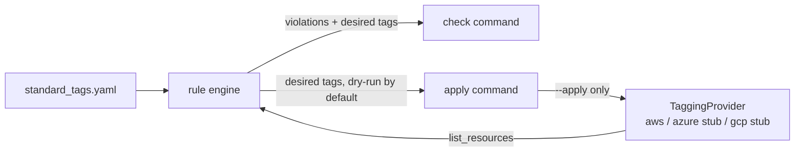

# Cloud resource tagging CLI

A Python CLI that checks and bulk-fixes AWS resource tags. Azure and GCP remain interface-only stubs that raise `NotImplementedError`. Validation uses fakes in CI.

## Problem

Teams accumulate resources tagged inconsistently across clouds and over
time: `Environment: Prod` next to `environment: production` next to nothing
at all. This tool defines one standard-tags policy, reports who's out of
line (`check`), and brings them into line (`apply`), without ever guessing
a value it can't justify.

## Scope

Only **AWS** has a real adapter, built on the
[Resource Groups Tagging API](https://docs.aws.amazon.com/resourcegroupstaggingapi/latest/APIReference/)
(`GetResources` / `TagResources`), which is why one adapter covers every
taggable AWS resource type instead of needing a client per service.

**Azure and GCP are interface-only.** `AzureProvider` and `GcpProvider`
implement the same `TaggingProvider` protocol but every method raises
`NotImplementedError` immediately — they exist to show the interface is
multi-cloud by design, not to claim working support. Wiring in a real
adapter means implementing `list_resources` / `set_tags` against that
cloud's SDK; the CLI and the check/apply logic do not change.

## How it works



For every resource, the rule engine compares its current tags against the
policy and classifies each mismatch:

| Violation | Fixable automatically? |
|---|---|
| Required tag missing, policy has a `default` | yes — default is applied |
| Required tag missing, no `default` | no — reported, left alone |
| Tag value has wrong case (`PROD` vs `prod`) | yes — value is normalized |
| Tag value not in `allowed_values` | no — reported, left alone |

`check` only reports. `apply` reports and, with `--apply`, writes the
fixable changes. A resource that's already correct produces no API call at
all, in either command — that's what makes repeated runs idempotent.

## Usage

```bash
pip install -e .

# report non-conforming resources, exit 1 if any exist
cloud-tag check --config examples/standard_tags.yaml

# show what would change, writes nothing
cloud-tag apply --config examples/standard_tags.yaml

# actually write the fixable tags
cloud-tag apply --apply --config examples/standard_tags.yaml

# azure/gcp are stubs: this raises NotImplementedError on purpose
cloud-tag check --provider azure --config examples/standard_tags.yaml
```

Config format (`examples/standard_tags.yaml`):

```yaml
tags:
  - key: Environment
    required: true
    case: lower              # lower | upper | kebab | none
    allowed_values: [prod, staging, dev]
  - key: Owner
    required: true
    case: lower
    default: unassigned      # auto-filled when missing
  - key: CostCenter
    required: false
    case: upper
```

## Known limitations

- Only AWS has working code against a real API shape; Azure/GCP are stubs.
- `apply` never guesses a disallowed or missing-with-no-default value — it
  reports it and exits non-zero, so a human decides.
- No batching/rate-limit backoff beyond what `TagResources` itself does in
  one call per resource; fine for the scale this was built for, not for
  thousands of resources per run.

## Security

No credentials are read, stored, or required to run or test this project.
The AWS adapter takes an already-constructed `boto3` client — real
credential handling is the caller's problem, not this tool's. If wired to
a real AWS account, the IAM principal needs at minimum:
`tag:GetResources` and `tag:TagResources` on the resources being managed.
This project has never been run against a real AWS account.

## Idempotency

`apply` computes a diff (`desired_tags`) between current and policy-correct
tags. When the diff is empty, no `set_tags`/`TagResources` call is made.
Running `apply --apply` twice in a row produces zero additional API calls
on the second run — covered by `test_apply_is_idempotent_on_second_run`.

## Validation level

Tested: rule engine (all four violation kinds, including negative cases),
config loading (valid + four malformed-config negative cases), the AWS
adapter against a hand-written fake of the boto3 client (pagination,
tagging failure handling), and the CLI end-to-end via Click's `CliRunner`
with that same fake client injected. 29 tests, all passing.

Not tested: real AWS (no network calls anywhere in the suite), Azure/GCP
(interface-only, verified only to raise `NotImplementedError`), and
large-scale pagination/throttling behavior beyond what the fake simulates.
